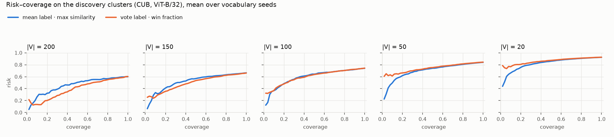
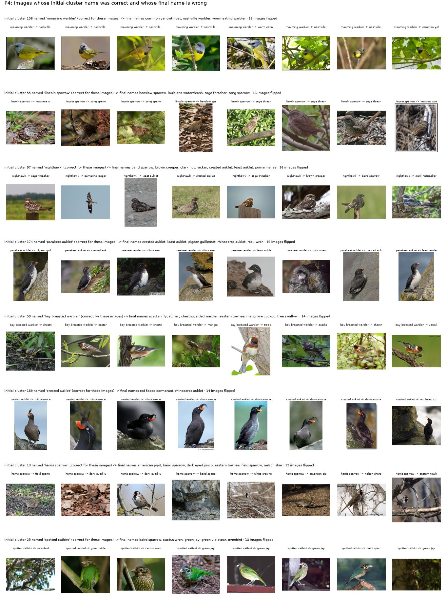
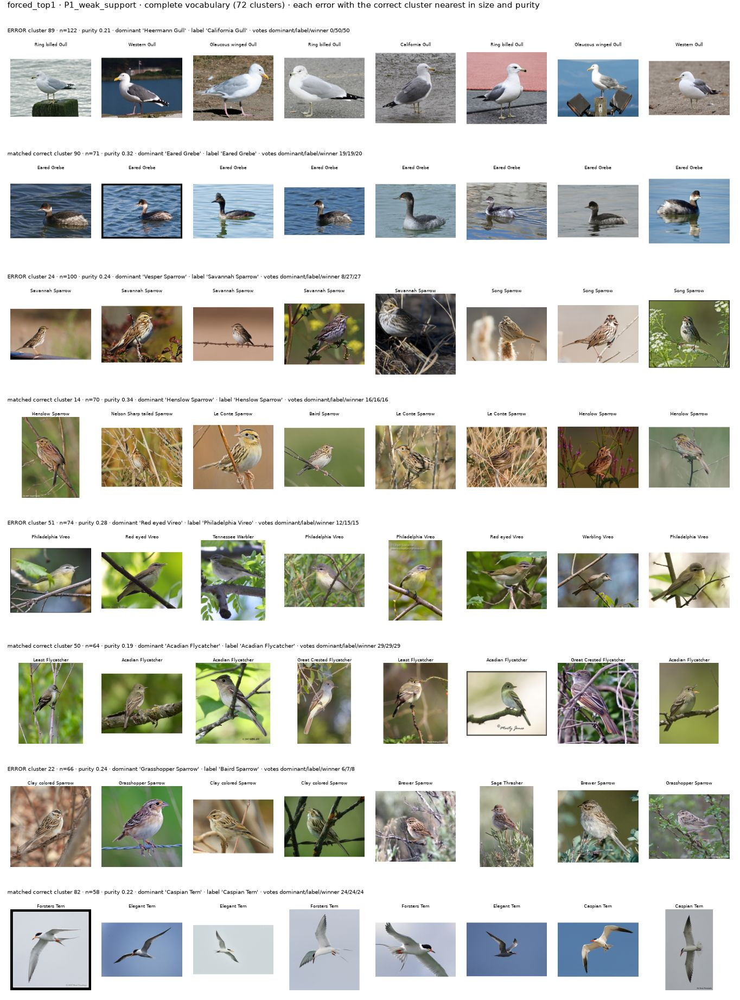

# Experiment 2: SCD reproduction and its naming component in the grounding protocol

**Naming.** *SCD* is the paper's term (Semantic Category Discovery; Han, Huang, Li, Vaze, Li, Jia, "What's in a Name?
Beyond Class Indices for Image Recognition", CVPR-W 2024, arXiv:2304.02364v2). `SCD/` is **our folder** with our
re-implementation; `Experiment2_SCD/` is this experiment. Every number below is in `GENERATED_TABLES.md` (read from
`outputs/`) or is computed from files named next to it. Protocol definitions: `../PROTOCOL.md`. Inspection of the
paper, code and assets: `../docs/INSPECTION.md`.

## 1. Status

| Stage | Kind | State |
|---|---|---|
| Inspection of paper, official code (commit `2ce64f7`) and README; 18 discrepancies/defects documented | analysis | done |
| `SCD/` re-implementation (vocabulary, text weights, top-k, votes, pool, Munkres assignment, reassignment, loop, CSS-k-means, metrics) | software | done; 22 unit tests pass |
| WordNet vocabulary rebuilt and verified against the authors' embeddings | **real-data check** | passed: 67,893/67,893 columns; 80-template min cosine 0.99959 on 382 positions; one-template retrieval of the own column 99.97% |
| CUB embeddings recomputed for Experiment 1's 8,878 rows and validated against Experiment 1 | **real data** | done: identity hash equal, max \|ΔA\| 1.8e-5, 97,860/97,860 saved predictions reproduced |
| Protocol B (CUB, fixed GCD clusters, ViT-B/32): mean vs vote labels, forced and UNMAPPED, all episodes | **completed research run** | done (training seed 0, clustering seed 0) |
| Protocol R (CUB, SCD refinement from GCD clusters, closed 200-name vocabulary) | **completed research run** (not a paper setting) | done: 3 clustering seeds × 2 modes |
| Protocol A (ImageNet-100 reproduction) | software path checked on synthetic data only | **pending**: needs ImageNet + a GPU (`kaggle/e2_imagenet100.ipynb`) |
| Protocols B/R through their entry points on Experiment 1's synthetic smoke run; protocol-A smoke | software check only | pass (not results) |
| Experiment 2 unit tests | software | 11 pass |
| CC12M textual enhancement | — | documented only (`docs/EXTENSION_TE.md`) |

Pending commands (protocol A), on a GPU machine with the Experiment 1 ImageNet-100 manifest, or the notebook:

```bash
e2in() { python -m e2 --config configs/imagenet100.yaml --set=e1.runs_root=<Experiment 1 runs> "$@"; }
e2in vocab && e2in repro features && e2in repro cluster && e2in repro name && e2in repro evaluate && e2in report
```

## 2. Reproduced configuration and deviations

**Vocabulary.** The official noun file is not distributed; its embeddings are (fp16, 512 × 67,893). The list is
rebuilt as the unique *raw, case-sensitive* first lemma of every WordNet 3.0 noun synset in `all_synsets('n')`
order: exactly 67,893 names (every other rule gives 61,109–67,889). Verified (`outputs/vocabulary/*/alignment.json`):
80-template weights recomputed from the names (open_clip ViT-B/16, fp32) match the stored fp16 columns with minimum
cosine 0.99959 on 382 seeded positions; a one-template text retrieves its own column for 99.97% of all 67,893 names
(top-5: 99.996%); the same check on sorted order fails (minimum cosine 0.49). After the official normalisation
(`lower`, `-`→`_`) 712 names occur twice: 707 are case variants with identical vectors (CLIP lower-cases), 5 are
hyphen/underscore spellings with different vectors (cosine 0.974–0.994, e.g. `knife_edge`/`knife-edge`). Two
ImageNet-100 known classes ('dalmatian', 'cardigan') have duplicate columns.

**Protocol A configuration (fixed, not yet run).** CLIP ViT-B/16 via the official package (fp16), CLIP preprocessing for
CLIP, DINO and GCD features (as the official code), authors' ImageNet-100 GCD backbone, k-means (seed 0 = official
`random_state=0`, plus 1, 2), CSS-k-means re-implemented (size 50–1000, 10 × 10, seeded), official naming values
(top-3 votes, 10 candidates per cluster, 2 per cluster in the matrix, sklearn Munkres, stop on an unchanged name set).

| Deviation from the official code | Why | Where visible |
|---|---|---|
| logits in fp32, ties to the lowest vocabulary index (official: fp16, CUDA tie order) | determinism; an fp16-emulation variant is also run | variant `fp16_logits` |
| iteration limit 50 + cycle detection | the official loop has no exit if names cycle | `stop_reason` in every trace |
| pool deepened when the official code would raise `KeyError` | insufficient candidates | `repairs` in every trace |
| CSS-k-means seeded (official unseeded), returns the true iteration count | determinism; defect 17 | fidelity label |
| ptsup cluster order by position instead of string-set order | the official order changes with `PYTHONHASHSEED` | INSPECTION §3.15 |
| own feature extraction (no CLIP ImageNet-100 features are distributed) | asset gap | fidelity label `official-assets` |
| repairs as separate variants: duplicate columns merged; known-name filter in vocabulary space | defects 10, 11 | variants `merged_duplicates`, `known_filter_fixed` |

Published numbers (paper Tables 1–2, ImageNet-100 All) will be compared only for the `official` variant on the
seed-0 initial clusterings: unsupervised sACC 41.2 / Soft-sACC 71.3 / ACC 78.2 (k-means init 73.2); partially
supervised 54.8 / 77.5 / 83.0 (CSS-k-means init 78.7); zero-shot UB 85.0 / 92.0, Baseline 22.7 / 57.7.

## 3. Protocol B: naming Experiment 1's fixed clusters (CUB, ViT-B/32)

Same clusters (training seed 0, clustering seed 0, K = 200), members, CLIP, prompts (dev-selected `ensemble80`, T* 0.02),
episodes, pools and evaluation population as Experiment 1. Experiment 1's methods were recomputed: forced and
end-to-end accuracies equal its saved values exactly; AURC/AUROC differ in 53 and 76 of 6,210 rows by at most
5.5e-5 / 6.2e-4 (score differences of ~1e-5 between this machine and the Kaggle T4 reorder near-tied clusters).

### 3.1 Forced naming

Complete vocabulary (200 names), 4,496 discovery images; 95% cluster-bootstrap intervals; Δ is paired against the
mean label on the same replicates.

| Label rule | Accuracy % | 95% CI | Old % | New % | Δ vs mean (pp) |
|---|---|---|---|---|---|
| mean similarity (Experiment 1) | 40.0 | [35.2, 45.4] | 48.9 | 35.6 | – |
| plurality vote (k = 1, dev-selected) | 39.6 | [35.0, 44.9] | 47.9 | 35.5 | −0.4 [−1.8, +1.1] |
| top-3 vote (official k) | 37.2 | [32.5, 43.0] | 46.6 | 32.6 | −2.8 [−5.1, −0.6] |
| top-5 vote | 34.9 | [29.9, 40.4] | 47.0 | 28.8 | −5.2 [−8.3, −2.8] |
| SCD distinct names (top-3, 10/2, Munkres) | 37.6 | [32.9, 42.9] | 49.3 | 31.7 | −2.4 [−5.6, +0.7] |

Incomplete vocabularies (forced accuracy on images whose class is available, mean over 5 episodes): mean
45.2 / 51.9 / 63.9 / 78.9 at 150 / 100 / 50 / 20 names, plurality 45.5 / 51.5 / 62.7 / 76.9. The dev pool chose k = 1
(dev AURC 0.465 vs 0.520 for k = 3 and 0.571 for k = 5).

**Finding B1.** Replacing the cluster mean by per-image plurality voting does not change forced naming (−0.4 pp,
interval covers 0); SCD's top-k voting is worse (top-3 −2.8 pp, top-5 −5.2 pp). The two labels differ for 631 of
4,496 images at 200 names, and the disagreements cancel: 139 images are right only under the mean, 121 only under
the vote.

### 3.2 UNMAPPED rejection

Thresholds τ_e2e from the calibration pool (Experiment 1's rule: maximise pooled end-to-end accuracy). AUROC: image
level, positive = the image's class is in the vocabulary. End-to-end: accepted and correct, or absent and rejected.

| Score (label) | AUROC 150 / 100 / 50 / 20 | Coverage % 200 / 150 / 100 / 50 / 20 | End-to-end % 200 / 150 / 100 / 50 / 20 |
|---|---|---|---|
| max_mean_sim (mean label; Experiment 1 reference) | 0.633 / 0.654 / 0.749 / 0.820 | 64.7 / 56.9 / 46.1 / 29.2 / 15.2 | 29.0 / 37.6 / 48.5 / 69.0 / 84.4 |
| vote_fraction (mean label; Experiment 1) | 0.545 / 0.569 / 0.631 / 0.696 | 7.5 / 8.9 / 9.8 / 14.4 / 18.9 | 6.6 / 30.8 / 53.5 / 71.3 / 79.5 |
| win_fraction (vote label) | 0.540 / 0.565 / 0.629 / 0.701 | 7.5 / 8.9 / 9.8 / 14.4 / 18.9 | 6.6 / 30.8 / 53.5 / 71.3 / 79.5 |
| margin (vote label) | 0.521 / 0.543 / 0.608 / 0.686 | 13.5 / 16.9 / 18.7 / 23.3 / 30.9 | 11.2 / 32.9 / 52.4 / 68.2 / 70.1 |
| neg_entropy (vote label) | 0.543 / 0.583 / 0.643 / 0.708 | 12.8 / 13.0 / 13.3 / 14.8 / 16.4 | 11.1 / 32.8 / 53.1 / 71.2 / 81.0 |
| mean_sim of the vote winner | 0.628 / 0.652 / 0.747 / 0.820 | 62.8 / 55.5 / 45.9 / 29.0 / 15.2 | 28.2 / 37.4 / 48.5 / 69.1 / 84.3 |

Paired cluster-bootstrap differences against max_mean_sim (win_fraction): AUROC −0.093 [−0.134, −0.054] at 150,
−0.089 [−0.117, −0.062] at 100, −0.119 [−0.151, −0.091] at 50, −0.118 [−0.155, −0.082] at 20; end-to-end −22.3 pp at
200, −6.8 at 150, **+4.9 [+0.9, +8.9] at 100**, +2.3 [−0.7, +5.6] at 50, −5.0 [−8.8, −1.1] at 20.

Ranking by correctness instead of availability (risk–coverage; lower AURC is better; AUROC with positive = "available
and correctly named"), mean over episodes:

| Score | AURC 200 / 150 / 100 / 50 / 20 | AUROC (available and correct) 200 / 150 / 100 / 50 / 20 |
|---|---|---|
| max_mean_sim (mean label) | 0.450 / 0.516 / 0.587 / 0.695 / 0.819 | 0.655 / 0.666 / 0.702 / 0.777 / 0.845 |
| win_fraction (vote label) | **0.391 / 0.493** / 0.595 / 0.743 / 0.862 | **0.767 / 0.715 / 0.716** / 0.737 / 0.771 |
| neg_entropy (vote label) | **0.392 / 0.487** / 0.590 / 0.741 / 0.862 | **0.765 / 0.722 / 0.722** / 0.740 / 0.768 |



**Finding B2.** The two kinds of confidence measure different things, and which is better depends on how complete the
vocabulary is. *Availability* (is the true name in V?): vote-based scores are worse than the cluster-mean similarity
at every incomplete size (AUROC lower by 0.07–0.14, all intervals below 0). *Correctness* among clusters: with large
vocabularies (200, 150 names) vote agreement ranks clusters better (AURC 0.391 vs 0.450 at 200 names; AUROC for
"available and correct" 0.767 vs 0.655), with small ones (50, 20) the similarity magnitude is better. The vote winner's
own mean similarity behaves like max_mean_sim (AUROC within 0.005), so the availability information sits in the
similarity magnitude and the correctness information partly in member agreement. Under Experiment 1's pooled
calibration the vote scores accept only 8–19% of images; the end-to-end gain at 100 names comes from rejecting almost
everything when most labels are absent and becomes a loss at 200 and 150 names: one pooled threshold cannot serve all
sizes. Win fraction and Experiment 1's vote_fraction accept the same clusters at their thresholds.

## 4. Protocol R: SCD refinement from Experiment 1's GCD clusters (CUB; not a paper setting)

Official naming values, closed vocabulary of the 200 CUB names (|V| = K), `known_filter = fixed`. Initial = the
GCD clusters named by SCD's iteration-1 votes (distinct names), before any reassignment.

| Clustering seed | Mode | Initial sACC % (Old / New) | Final sACC % (Old / New) | Final − initial sACC, pp (paired image bootstrap) | ACC % initial → final | Iterations | Names (iter. 1) | Flips correct→wrong / wrong→correct |
|---|---|---|---|---|---|---|---|---|
| c0 | unsupervised | 37.6 (49.3 / 31.7) | 49.2 (53.4 / 47.0) | +11.6 [+9.9, +13.1] | 50.8 → 51.2 | 2 | 197 | 494 / 1,015 |
| c1 | unsupervised | 36.8 (46.6 / 31.9) | 49.2 (53.4 / 47.0) | +12.4 [+10.8, +13.9] | 49.7 → 51.2 | 2 | 197 | 450 / 1,006 |
| c2 | unsupervised | 36.5 (47.4 / 31.1) | 49.2 (53.4 / 47.0) | +12.7 [+11.1, +14.3] | 49.9 → 51.2 | 2 | 197 | 479 / 1,049 |
| c0 | partially supervised | 41.5 (81.4 / 21.5) | 49.2 (53.4 / 47.0) | +7.7 [+5.8, +9.5] | 50.8 → 51.2 | 2 | 196 | 651 / 998 |
| c1 | partially supervised | 40.9 (81.1 / 20.8) | 49.2 (53.4 / 47.0) | +8.3 [+6.4, +10.0] | 49.7 → 51.2 | 3 | 194 | 650 / 1,022 |
| c2 | partially supervised | 38.9 (79.9 / 18.5) | 49.2 (53.4 / 47.0) | +10.3 [+8.3, +12.0] | 49.9 → 51.2 | 3 | 193 | 656 / 1,117 |

**Finding R1.** All six runs end at the same state, and that state is per-image zero-shot CLIP classification: the
final sACC (49.18%) equals the accuracy of each image's own top-1 over the 200 names (49.18%, computed from the saved
similarity matrix). In iteration 1 the votes already select 193–197 of the 200 names (the official code would crash:
the pool is smaller than the number of clusters; the repair deepened it and left 3–7 slots unnamed), so the first
reassignment discards the clustering. With |V| ≈ K, SCD's refinement *is* zero-shot classification.

**Finding R2.** That replacement helps novel classes and hurts anchored known classes. Partially supervised, Old
sACC falls from ~81% (anchored clusters keep their labelled class name) to 53.4%, New rises from ~20% to 47.0%; 650
images per run go from correct to wrong (pattern P4). The per-image top-1 (49.2%) beats any single-label naming of
the GCD clusters (40.0%) because 2,147 of 4,496 discovery images (47.8%) are not of their cluster's dominant class and
cannot be right under one cluster label.



*P4 gallery (clustering seed 0, partially supervised): coherent GCD clusters that were named correctly (e.g. Crested
Auklet, Parakeet Auklet, Mourning Warbler) lose their name when each image takes its own CLIP top-1 (Crested Auklet
→ Rhinoceros Auklet for 7 of the 8 images shown).*

Uncertainty: memberships change, so Experiment 1's cluster bootstrap does not apply. The final − initial difference
uses a paired image bootstrap conditional on each run (it ignores clustering randomness); clustering-seed variation is
shown by the three seeds (the final state does not vary, by R1).

## 5. Failure analysis (protocol B, complete vocabulary unless stated)

Measurable definitions are in `e2/errors.py`; all incorrect decisions are exported in
`outputs/cub/fixed_cluster/vitb32/seed0_known_c0/<hash>/errors/` (image-level, with paths, labels, availability,
predictions, scores, votes, rejection outcome, composition). Galleries pair every shown error with the correct
cluster nearest in size and purity (`figures/B_*.jpg`; all galleries in `outputs/.../errors/galleries/`).

| Pattern | Mean label | Plurality vote | SCD distinct names |
|---|---|---|---|
| wrong cluster labels (of 200) | 79 (1,851 images) | 82 (1,967) | 111 (2,171) |
| **P1** true name available, members do not vote for it | **72** (1,734 images); median member support for the true name **0** | 78 | 65 |
| **P2** members' plurality is the true name, label differs | 7 (0 with a strict majority) | 4 (ties) | **46 (28 with a strict majority)** |
| **P3** label shared with another cluster | 60 (48: the label is another cluster's dominant class) | 65 (54) | 0 by construction |
| **P5** mixed clusters (purity ≤ ½) | 68 clusters, 2,524 images; error 51% vs 33% for pure | 53% vs 35% | 60% vs 53% |
| **P6** related name (same head word / among the 5 text-nearest names) | 44 (40 / 35) | 45 (41 / 34) | 49 (45 / 43) |
| names given that no member voted for | 4 | 0 | **65** |

Image-level patterns at τ_e2e (pooled over a size's episodes):

| | max_mean_sim 150 / 100 / 50 / 20 | win_fraction 150 / 100 / 50 / 20 |
|---|---|---|
| **P7** absent-label images accepted | 43.5 / 36.8 / 20.8 / 11.4 % | 6.0 / 5.9 / 11.9 / 16.4 % |
| **P8** available images rejected | 38.5 / 44.7 / 45.5 / 48.3 % | 90.1 / 86.3 / 78.0 / 57.5 % |
| of the rejected available images, the label would have been correct | 2,350 / 2,024 / 1,425 / 740 | 6,100 / 4,352 / 2,346 / 772 |

Readings (measured unless marked *hypothesis*):

1. **The bottleneck is per-image evidence, not aggregation.** When the true name is available but the label is wrong,
   the members almost never vote for the true name (P1: 72 of 79; median support 0). Aggregation overriding a correct
   majority (P2) never happens with the mean or the plurality vote. This is why the vote label cannot beat the mean.
   For wrong images the true class has median rank 3 of 200 in the image's own similarities: close, but not first.
2. **Distinctness fails where GCD splits a species.** 37 species dominate more than one cluster (81 clusters) and 44
   dominate none. Forcing distinct names takes a strictly-majority-supported correct name from 28 clusters (19 of them
   split species) and hands 65 clusters a name that none of their members voted for. SCD's assumption "one cluster per
   class" is what fails, not the votes.
3. **Competition without distinctness.** With independent decisions, 60 of the 79 wrong labels are shared with another
   cluster and 48 are the dominant class of that other cluster — duplicates and splits are the same phenomenon seen
   from the other side.
4. **Mixed clusters cap any single-label method.** 47.8% of images are not of their cluster's dominant class; mixed
   clusters are wrong more often (51% vs 33%).
5. **Related names.** About half of the wrong labels share the head word with the truth ('… Sparrow', '… Gull', '…
   Vireo') or are among its five text-nearest names. *Hypothesis:* these are fine-grained visual confusions that CLIP
   ViT-B/32 cannot resolve from the image; the galleries are consistent with this (e.g. gull and sparrow clusters) but
   it needs human judgement per case. Some failures look like name-form problems instead: the cluster dominated by
   *Geococcyx* (a genus name rather than a common name) receives 0 votes for it.
6. **Rejection.** Mean-similarity rejection accepts many absent-label images (P7, 44% at 150 names); vote-based
   scores reject most available ones (P8, 86–90% at 150–100 names), half of them correctly labelled.

Galleries (complete vocabulary; each error row is followed by its matched correct cluster):
[P1 weak support](figures/B_forced_top1_P1_weak_support.jpg),
[P2 under distinct names](figures/B_distinct_top3_forced_P2_aggregation_override.jpg),
[P3 competition](figures/B_forced_top1_P3_competition.jpg), [P5 mixed](figures/B_forced_top1_P5_mixed.jpg),
[P6 related names](figures/B_forced_top1_P6_related_name.jpg); galleries for every method and pattern are in `outputs/cub/fixed_cluster/vitb32/seed0_known_c0/<hash>/errors/galleries/`.



The research question raised after Experiment 1 (Q2, "do wrongly named clusters behave differently?") is partly
answered here at cluster level: wrongly named clusters are those whose members' own top-1 rarely names the truth
(P1), clusters of split species (P3/P2 under distinctness) and mixed clusters (P5).

## 6. What this says about a justified improvement

* Swapping the mean for votes as the *label* is not the lever (B1, P1–P2). As a *confidence*, member agreement adds
  information about correctness when the vocabulary is nearly complete, but not about whether the name is available
  at all (B2).
* SCD's two structural components each fail in a measurable, specific way on GCD clusters: the distinct-name
  constraint breaks on split species (P2 under distinctness, 28 strict-majority overrides), and reassignment through
  CLIP replaces the clustering by zero-shot classification when the vocabulary is close to complete (R1), trading
  anchored known classes for novel ones (R2).
* The evidence therefore points to methods that (a) keep cluster structure where it is reliable (anchored clusters),
  (b) let individual images leave a cluster when their own evidence is strong, and (c) allow a name to be shared by
  several clusters when each has majority support.

## 7. Next experiments (each tied to a pattern)

1. **Anchor-preserving refinement (R2, P4).** Keep labelled-anchor clusters and their names fixed; reassign only
   images of unanchored clusters through CLIP. Prediction from R2: Old near 81% with New near 47%. Run on protocol R
   seeds 0–2; settings on the dev pool.
2. **Split-aware assignment (P2 under distinctness, P3).** Replace the one-to-one Hungarian step by a capacity-2
   min-cost flow, or allow a duplicate name when the cluster's vote for it is a strict majority; evaluate on the
   complete vocabulary in protocol B and inside the loop in protocol R.
3. **Image-level override (P5, R1).** Keep the cluster label by default but let an image take its own top-1 when its
   margin over the cluster label exceeds a dev-selected threshold — between "cluster label for all" (40.0%) and
   "per-image" (49.2%).
4. **Better per-image evidence (P1, P6).** Descriptive prompts (CuPL-style) or a stronger backbone (ViT-B/16,
   reported separately per PROTOCOL), measured by the drop in P1 count and in same-head-word confusions; treat
   genus-only names such as *Geococcyx* by adding the common name as an alias.
5. **Two-signal confidence with size-aware calibration (B2, P7/P8).** Availability is carried by the similarity
   magnitude and correctness partly by member agreement; combine them (e.g. reject when either max similarity or
   win fraction is low, or a dev-fitted logistic score of both) and calibrate per vocabulary size, since one pooled τ
   is too strict for large vocabularies and too loose for small ones.
6. **Protocol A on Kaggle.** Run the ImageNet-100 reproduction to see whether these CUB findings hold where the
   vocabulary (67,893 names) is much larger than K, so that distinctness and reassignment have slack.
